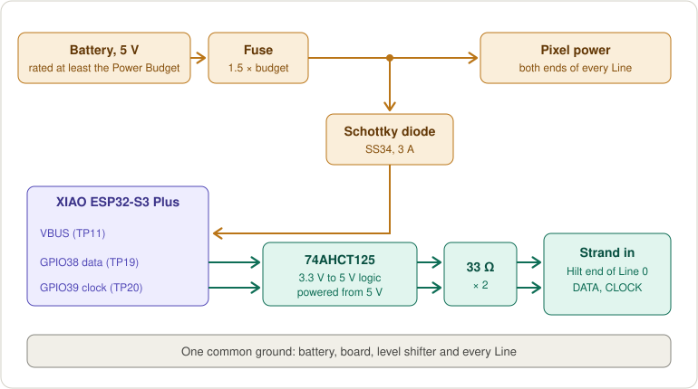
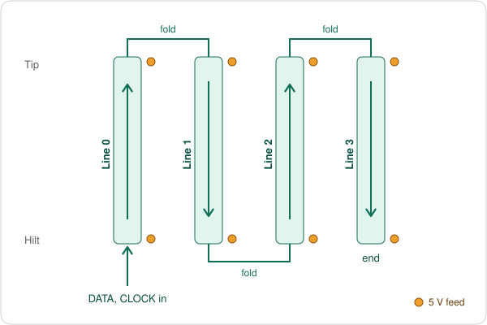

# LED build guide

How to wire SK9822/APA102 Pixels to the XIAO ESP32-S3 Plus display board for a
Dong, power them, and bring them up safely. Pins, pad names and the firmware
settings match [src/profiles.h](../src/profiles.h); words like Line, Strand and
Power Budget are defined in [CONTEXT.md](../CONTEXT.md).

## Parts

| Part | Notes |
|------|-------|
| SK9822 or APA102 strip, 5 V | 60 Pixels/m is what the profiles assume; 144/m works but needs far more current. Four Lines of the Blade's length, plus spare. |
| 74AHCT125 (or 74HCT245) | Lifts the board's 3.3 V signals to 5 V. Must be an **AHCT/HCT** part: it accepts 3.3 V as a high input. |
| 2 × 33–47 Ω resistors | In series on data and clock, right after the level shifter, to calm ringing on long wires. |
| Schottky diode, 3 A (e.g. SS34) | From the 5 V supply to the board's VBUS pad, so the supply can't push current back into a USB host. |
| Fuse, slow-blow | About 1.5× the Power Budget, at the battery. |
| 1000 µF, 10 V electrolytic | Across 5 V and GND where power enters the Strand. |
| Wire | Signal: 22–24 AWG. Power trunk: 20 AWG up to 3 A, 18 AWG up to 6 A, 16 AWG above. |
| Battery | See [Power](#power). |

## Pins on the display board

Only four GPIOs are free; they are solder pads on the carrier.

| Signal | GPIO | Pad | Used by |
|--------|------|-----|---------|
| Strand 0 data | 38 | TP19 (D11) | all profiles |
| Strand 0 clock | 39 | TP20 (D12) | all profiles |
| Strand 1 data | 40 | TP21 (D13) | two-Strand builds |
| Strand 1 clock | 42 | TP15 (D15) | two-Strand builds |
| 3.3 V | | TP17 | level shifter logic side, if your part needs it |
| GND | | TP6, TP16, TP18 | common ground |
| 5 V in | | TP11 (VBUS) | powering the board from the battery, through the Schottky diode |

The display, IMU, buttons and microphone use every other pin. None of the
free pins can read an analog voltage, so pack voltage can't be sensed on this
board (see [Power](#power)).

## Wiring the signals

1. Power the 74AHCT125 from **5 V** and GND. Tie its output-enable pins
   (1OE, 2OE) to GND, and unused inputs to GND.
2. GPIO38 → input 1A, output 1Y → 33 Ω → the Strand's **data** (DI/SDI).
   GPIO39 → input 2A, output 2Y → 33 Ω → the Strand's **clock** (CI/CKI).
3. Keep the level shifter close to where the Strand starts; the run from the
   shifter to the first Pixel is the one that matters.
4. Ground the shifter, the board and the Strand together.

The firmware clocks the Pixels at 12 MHz on the 1 m profile and 8 MHz on the
others (`LED_DATA_MHZ`). With long or messy wiring, drop it to 4 MHz before
blaming anything else.

## Folding one Strand into four Lines

The profiles fold one Strand up and down the Blade: Line 0 from the Hilt up to
the tip, Line 1 back down, Line 2 up, Line 3 down. Data enters at the Hilt end
of Line 0. Lines face four sides of the rod, 90° apart, in order around it.

- Cut the strip at each fold and bridge DO/CO to the next segment's DI/CI with
  short wires. If you bend the strip instead, the Pixels hidden in the fold
  must be skipped: set `skipBefore` on the next segment in the profile.
- Which side Line 0 faces doesn't matter for wiring: Mounting Calibration
  learns the board's orientation in the Hilt afterwards.
- A different layout (two Strands, another order, Lines starting at the tip) is
  only a profile edit; see the existing profiles for examples.

## Power

### How much current

Measured by running the firmware's Renderer over a minute of simulated
swinging, with the default 15% Clear Sky, before the Power Budget limits it
(20 mA per colour channel at full, 1 mA idle per Pixel; real strips vary, so
check with a USB or clamp meter):

| Build | Brightness 25% | 50% | 75% | 100% | Full white |
|-------|----------------|-----|-----|------|------------|
| 1 m, 4 × 60 Pixels | 1.9 A | 3.5 A | 5.1 A | 6.7 A | 14.6 A |
| 2 m, 4 × 120 Pixels | 3.7 A | 6.9 A | 10.1 A | 13.3 A | 29.3 A |

Peaks run about 10% above these means. Rainbow clouds draw about 45% of
full-white current, because most of each saturated color is lit.

The firmware never draws more than the profile's **Power Budget**
(`power.budgetMilliamps`): it dims every frame just enough to stay under it.
So with the 1 m profile's 3 A budget, brightness steps above about 40% all
look the same. To use them, raise the budget together with a supply that can
deliver it.

### Battery

- **USB power bank (simplest):** 5 V out, rated at least the Power Budget
  (most give 2.4–3 A; check the per-port limit, not the total). A 20,000 mAh
  bank runs a 3 A Dong for roughly 4 hours. The bank's own protection cuts
  off when empty; the firmware can't see its charge.
- **LiPo + 5 V converter (for more current):** a 2S pack and a 5 V buck
  converter rated 10 A or more, for the 2 m build. Put the fuse at the pack
  and follow the pack's charging rules.

Battery percentage needs an analog pin, and none is free on this carrier. The
options are a 1S LiPo on the board's own JST connector (its built-in divider
reads it on GPIO10; set `BATTERY_PIN 10` and a divider ratio of about 2.975),
or an I²C fuel gauge on the Grove port (needs firmware work).

### Feeding the Strand

- Feed 5 V and GND into **both ends of every Line** (every Line end is close
  to a fold, so this is short jumpers from the trunk). On 2 m Lines also feed
  the middle. Without this, the far end turns dim and pinkish as the voltage
  drops.
- One thick trunk from the battery runs up the rod; thin jumpers branch to
  each feed point.
- Never power Pixels from the board's 3.3 V pad, and nothing beyond a short
  test strip through the USB cable.

### Powering the board

Feed the board's VBUS pad (TP11) from the same 5 V, through the Schottky
diode, so one switch powers everything. Unplug the battery before
connecting USB to a computer, unless you have checked on the XIAO's schematic
that USB and VBUS can't feed each other.

## First light

Bring it up in small steps, with the `xiao` firmware (or your own profile):

1. **Short test strip first:** 8–10 Pixels on the bench, powered from the
   board's 5 V (VBUS pad) while it runs on USB. Set the profile's
   `pixelsPerLine` small and `power.budgetMilliamps` to 500 for this test.
2. **Colors:** pick the Rainbow Palette and look at the strip next to the
   display's Blade view. If red and blue are swapped (or any colors are
   wrong), change `LED_WIRE_ORDER` in `src/profiles.h` (`"BGR"` suits most
   strips; some APA102 clones want `"RGB"`).
3. **Flicker or garbage:** lower `LED_DATA_MHZ`, check the common ground and
   the level shifter's power.
4. **One Line, then the whole Strand,** on the real battery, with the Power
   Budget back to what the battery can deliver. Measure the current at full
   brightness and compare with the table above.
5. **Mount the board in the Hilt,** then run Mounting Calibration (hold C for
   5 s): Blade at the ceiling, then level with Line 0 on top.

## Profile checklist

Each physical build is one block in [src/profiles.h](../src/profiles.h) plus
an env in `platformio.ini`. Set:

- `bladeLength`, `hiltToFirstPixel` (metres), `pixelsPerLine`, `lineCount`
- the Strand layout: `segments` with `line`, `fromTip`, `skipBefore`
- `LED_STRAND0_DATA` / `_CLOCK` (and Strand 1's), `LED_DATA_MHZ`,
  `LED_WIRE_ORDER`
- `power.budgetMilliamps` to what the battery and wiring can carry
- `BUTTON_*_PIN` if the Dong has its own buttons
- `battery` only if a sensed pack is wired (`BATTERY_PIN` must be GPIO1–20)
