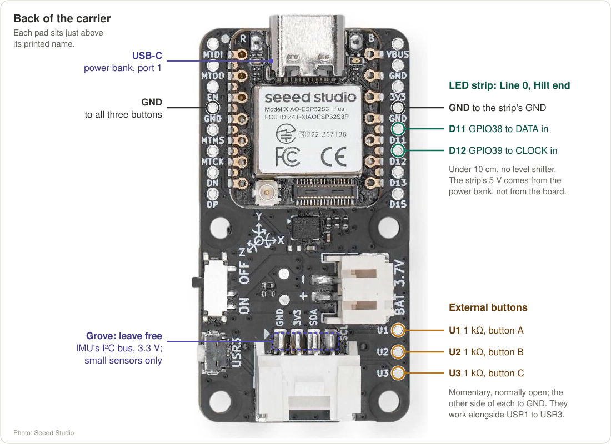

# LED build guide

How to wire SK9822/APA102 Pixels to the XIAO ESP32-S3 Plus display board for a
Dong, power them, and bring them up safely. Pins, pad names and the firmware
settings match [src/profiles.h](../src/profiles.h); words like Line, Strand and
Power Budget are defined in [CONTEXT.md](../CONTEXT.md).

## The 1 m prototype

The first Dong keeps it simple: a 1 m Blade, no level shifter, power fed only
at the Hilt, and a two-port USB power bank. The full build (below) adds the
level shifter and power at both ends of every Line, which a 2 m Blade needs.

The four Lines are one strip, cut into four 60-Pixel pieces and joined back
up with **folds**: four short wires (5 V, GND, DATA, CLOCK) from the end of
one Line to the start of the next, as the strip was before it was cut. Line
0's tip end joins Line 1's, Line 1's Hilt end joins Line 2's, and Line 2's
tip end joins Line 3's. Follow the arrows on the strip (DI/CI in, DO/CO
out). This is the single folded Strand the `xiao` profile expects.

### Where each wire goes on the carrier

All the solder points are on the back of the carrier. Each pad sits just
**above** its printed name, so the D11 pad is the one above the letters
"D11", not beside them. ([Unmarked photo](media/carrier-back.jpg), from
Seeed Studio.)

| From (pad on the carrier) | To | Notes |
|---|---|---|
| **D11** (GPIO38), right column | Line 0 **DI** (data in), at the Hilt | Under 10 cm, 22–24 AWG |
| **D12** (GPIO39), right column | Line 0 **CI** (clock in) | Same length, run next to D11's wire |
| **GND**, right column, just above D11 | Line 0 **GND** at the same end | Runs beside DATA and CLOCK |
| **U1**, **U2**, **U3** | 1 kΩ, then external buttons A, B, C | See [External buttons](#external-buttons) |
| **GND**, left column (4th pad) | The other side of all three buttons | |
| **USB-C** | Power bank port 1 | Ordinary USB-C cable |

Nothing on the board carries LED power. The Pixels' 5 V never touches the
board; only DATA, CLOCK and GND do.

### Power: a two-port power bank

- **Port 1** powers the board through its USB-C, exactly as on the bench.
- **Port 2** powers the Pixels through a cut USB cable: red is 5 V, black is
  GND. They go to a short 5 V and GND bus at the Hilt with a 1000 µF, 10 V
  capacitor across it.
- From the bus, a 5 V and GND jumper pair goes to the **Hilt end of every
  Line**: the start of Lines 0 and 2, the end of Lines 1 and 3. Nothing is
  fed at the tip; the folds there just join neighbouring Lines.
- Set the profile's `power.budgetMilliamps` to port 2's rating (the `xiao`
  profile assumes 3 A; many ports give 2.4 A). At 3 A each Line draws at most
  about 0.75 A, so a 1 m Line fed from one end dims by only a few tenths of a
  volt at the tip.
- The **1000 µF capacitor** is the only one this build needs. It soaks up
  the surge when the Pixels switch on and the power bank's slow response.
  Mind its polarity: the stripe goes to GND.
- Bus 20 AWG; jumpers 22 AWG.
- To flash, unplug port 1 and plug the computer in its place; the Pixels can
  stay on port 2.

### No level shifter

Each SK9822 re-sends DATA and CLOCK at its own 5 V, so only the wire from the
board to the first Pixel carries 3.3 V. That is below the 3.5 V an SK9822
wants for a "high" at 5 V, but works on a short wire at a low clock: the `xiao`
profile clocks the Pixels at 4 MHz (`LED_DATA_MHZ`), which is plenty for
240 Pixels.

The full build's 33 Ω resistors (in series on DATA and CLOCK) damp ringing
on the long wires after its level shifter. With under 10 cm from the board
to the first Pixel the prototype leaves them out.

If the first Pixels flicker or show wrong colors, add a **sacrificial Pixel**
instead of a level shifter: cut one Pixel off the strip, power it through an
ordinary silicon diode (1N4001 or similar, 5 V in, about 4.3 V out) and wire
it between the board and Line 0. At 4.3 V it reads 3.3 V signals reliably,
and its 4.3 V outputs drive the 5 V strip. Then set `skipBefore = 1` on the
profile's first segment so the firmware skips it.

## External buttons

The onboard buttons are hard to reach once the board is in the Hilt. Three
external momentary buttons (normally open, e.g. 12 mm panel-mount) wire in
parallel with them, so both work and the firmware doesn't change:

| Pad | GPIO | Button | Quick | Long (2 s) | Held (5 s) |
|---|---|---|---|---|---|
| U1 | 43 | A | next Palette | cloud size | Clear Sky |
| U2 | 44 | B | cloud motion | brightness | Girth |
| U3 | 11 | C | Status page | Re-level | Mounting Calibration |

- Each button: pad → **1 kΩ** → button → GND (left-column GND pad). The
  onboard buttons have the same 1 kΩ in series. It matters for U1: GPIO43 is
  the chip's serial TX while it boots, and a button pressed then would short a
  driven pin straight to ground.
- One 4-wire cable (U1, U2, U3, GND) reaches the button panel; twist it or
  keep it away from the Pixel CLOCK wire.
- These assignments are for the `xiao` profiles. The `xiao_screen` bench
  firmware puts A on USR3 instead, the button easiest to reach on a bare board.

## The Grove port

The Grove connector is the IMU's own I²C bus (GPIO5 and GPIO6, with 5.1 kΩ
pull-ups on the board) plus 3.3 V and GND. It can't drive Pixels: it has no
spare GPIOs, and Pixel data on that bus would corrupt the IMU's readings.
Small I²C sensors can share it:

- **Magnetometer** (e.g. MMC5603, LIS3MDL): an absolute compass heading, which
  would stop the Cloud Field slowly turning around the vertical. It must sit
  away from the Pixel power wires, whose current bends the field it measures.
- **Fuel gauge** (e.g. MAX17048): battery percentage for a LiPo build; this
  board has no free analog pin for it.
- **Ambient light sensor** (e.g. VEML7700): dim the Blade automatically in
  the dark, saving battery.
- **Knobs**: an M5Stack 8-Encoder unit (address 0x41) gives every setting its
  own knob; the firmware already supports it (README, *Knobs*). Plug it
  straight in. It wants 5 V but runs from Grove's 3.3 V: its regulator only
  feeds a 3.3 V rail, and with its LEDs off it draws about 20 mA.

Each needs firmware work: the IMU keeps the bus about half busy, so other
devices must be read from the IMU task between its samples. Their I²C
addresses must also differ from the IMU's (0x6A). Don't plug anything into
Grove while the board is powered.

## Full build

For a 2 m Blade, a long wire to the first Pixel, or a battery that also
powers the board.

### Parts

| Part | Notes |
|------|-------|
| SK9822 or APA102 strip, 5 V | 60 Pixels/m is what the profiles assume; 144/m works but needs far more current. Four Lines of the Blade's length, plus spare. |
| 74AHCT125 (or 74HCT245) | Lifts the board's 3.3 V signals to 5 V. Must be an **AHCT/HCT** part: it accepts 3.3 V as a high input. |
| 2 × 33–47 Ω resistors | In series on data and clock, right after the level shifter, to calm ringing on long wires. |
| Schottky diode, 3 A (e.g. SS34) | From the 5 V supply to the board's VBUS pad, so the supply can't push current back into a USB host. |
| Fuse, slow-blow | About 1.5× the Power Budget, at the battery. |
| 1000 µF, 10 V electrolytic | Across 5 V and GND where power enters the Strand. |
| Wire | Signal: 22–24 AWG. Power trunk: 20 AWG up to 3 A, 18 AWG up to 6 A, 16 AWG above. |
| Battery | See [Power](#power). |

### Pins on the display board

Only four GPIOs are free; they are the right-hand column of pads on the back
of the carrier, each just above its printed name.

| Signal | GPIO | Pad (as printed on the back) | Used by |
|--------|------|-----|---------|
| Strand 0 data | 38 | D11 | all profiles |
| Strand 0 clock | 39 | D12 | all profiles |
| Strand 1 data | 40 | D13 | two-Strand builds |
| Strand 1 clock | 42 | D15 | two-Strand builds |
| Buttons A, B, C | 43, 44, 11 | U1, U2, U3 | external buttons |
| 3.3 V | | 3V3 | level shifter logic side, if your part needs it |
| GND | | GND (right column, twice; left column) | common ground |
| 5 V in | | VBUS | powering the board from the battery, through the Schottky diode |

The display, IMU, buttons and microphone use every other pin. None of the
free pins can read an analog voltage, so pack voltage can't be sensed on this
board (see [Power](#power)).

### Wiring the signals

1. Power the 74AHCT125 from **5 V** and GND. Tie its output-enable pins
   (1OE, 2OE) to GND, and unused inputs to GND.
2. GPIO38 → input 1A, output 1Y → 33 Ω → the Strand's **data** (DI/SDI).
   GPIO39 → input 2A, output 2Y → 33 Ω → the Strand's **clock** (CI/CKI).
3. Keep the level shifter close to where the Strand starts; the run from the
   shifter to the first Pixel is the one that matters.
4. Ground the shifter, the board and the Strand together.

The firmware clocks the Pixels at 8 MHz on the 2 m and LightSwarm profiles
and 4 MHz on the 1 m prototype, which has no level shifter (`LED_DATA_MHZ`).
With a shifter in, the 1 m profile can go to 12 MHz; with long or messy
wiring, drop to 4 MHz before blaming anything else.

### Folding one Strand into four Lines

The profiles fold one Strand up and down the Blade: Line 0 from the Hilt up to
the tip, Line 1 back down, Line 2 up, Line 3 down. Data enters at the Hilt end
of Line 0. Lines face four sides of the rod, 90° apart, in order around it.

- Cut the strip at each fold and bridge DO/CO to the next segment's DI/CI with
  short wires. If you bend the strip instead, the Pixels hidden in the fold
  must be skipped: set `skipBefore` on the next segment in the profile.
- Which side Line 0 faces doesn't matter for wiring: Mounting Calibration
  learns the board's orientation in the Hilt afterwards.
- A different layout (two Strands, another order, Lines starting at the tip) is
  only a profile edit; see the existing profiles for examples.

### Power

#### How much current

Measured by running the firmware's Renderer over a minute of simulated
swinging, with the default 15% Clear Sky, before the Power Budget limits it
(20 mA per colour channel at full, 1 mA idle per Pixel; real strips vary, so
check with a USB or clamp meter):

| Build | Brightness 25% | 50% | 75% | 100% | Full white |
|-------|----------------|-----|-----|------|------------|
| 1 m, 4 × 60 Pixels | 1.9 A | 3.5 A | 5.1 A | 6.7 A | 14.6 A |
| 2 m, 4 × 120 Pixels | 3.7 A | 6.9 A | 10.1 A | 13.3 A | 29.3 A |

Peaks run about 10% above these means. Rainbow clouds draw about 45% of
full-white current, because most of each saturated color is lit.

The firmware never draws more than the profile's **Power Budget**
(`power.budgetMilliamps`): it dims every frame just enough to stay under it.
So with the 1 m profile's 3 A budget, brightness steps above about 40% all
look the same. To use them, raise the budget together with a supply that can
deliver it.

#### Battery

- **USB power bank (simplest):** 5 V out, rated at least the Power Budget
  (most give 2.4–3 A; check the per-port limit, not the total). A 20,000 mAh
  bank runs a 3 A Dong for roughly 4 hours. The bank's own protection cuts
  off when empty; the firmware can't see its charge.
- **LiPo + 5 V converter (for more current):** a 2S pack and a 5 V buck
  converter rated 10 A or more, for the 2 m build. Put the fuse at the pack
  and follow the pack's charging rules.

Battery percentage needs an analog pin, and none is free on this carrier. The
options are a 1S LiPo on the board's own JST connector (its built-in divider
reads it on GPIO10; set `BATTERY_PIN 10` and a divider ratio of about 2.975),
or an I²C fuel gauge on the Grove port (needs firmware work).

#### Feeding the Strand

- Feed 5 V and GND into **both ends of every Line** (every Line end is close
  to a fold, so this is short jumpers from the trunk). On 2 m Lines also feed
  the middle. Without this, the far end turns dim and pinkish as the voltage
  drops.
- One thick trunk from the battery runs up the rod; thin jumpers branch to
  each feed point.
- Never power Pixels from the board's 3.3 V pad, and nothing beyond a short
  test strip through the USB cable.

#### Powering the board

Feed the board's VBUS pad from the same 5 V, through the Schottky
diode, so one switch powers everything. Unplug the battery before
connecting USB to a computer, unless you have checked on the XIAO's schematic
that USB and VBUS can't feed each other.

### First light

Bring it up in small steps, with the `xiao` firmware (or your own profile):

1. **Short test strip first:** 8–10 Pixels on the bench, powered from the
   board's 5 V (VBUS pad) while it runs on USB. Set the profile's
   `pixelsPerLine` small and `power.budgetMilliamps` to 500 for this test.
2. **Colors:** pick the Rainbow Palette and look at the strip next to the
   display's Blade view. If red and blue are swapped (or any colors are
   wrong), change `LED_WIRE_ORDER` in `src/profiles.h` (`"BGR"` suits most
   strips; some APA102 clones want `"RGB"`).
3. **Flicker or garbage:** lower `LED_DATA_MHZ`, check the common ground and
   the level shifter's power.
4. **One Line, then the whole Strand,** on the real battery, with the Power
   Budget back to what the battery can deliver. Measure the current at full
   brightness and compare with the table above.
5. **Mount the board in the Hilt,** then run Mounting Calibration (hold C for
   5 s): Blade at the ceiling, then level with Line 0 on top.

### Profile checklist

Each physical build is one block in [src/profiles.h](../src/profiles.h) plus
an env in `platformio.ini`. Set:

- `bladeLength`, `hiltToFirstPixel` (metres), `pixelsPerLine`, `lineCount`
- the Strand layout: `segments` with `line`, `fromTip`, `skipBefore`
- `LED_STRAND0_DATA` / `_CLOCK` (and Strand 1's), `LED_DATA_MHZ`,
  `LED_WIRE_ORDER`
- `power.budgetMilliamps` to what the battery and wiring can carry
- `BUTTON_*_PIN` if the Dong has its own buttons
- `battery` only if a sensed pack is wired (`BATTERY_PIN` must be GPIO1–20)
